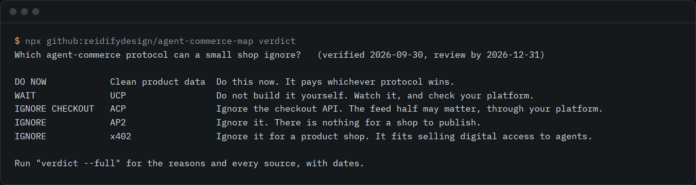
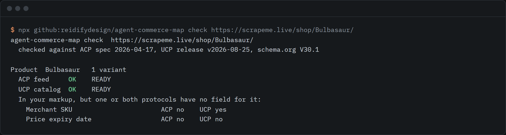

# agent-commerce-map

A dated crosswalk of ACP, UCP and schema.org Product fields, with a plain verdict on which agent-commerce protocol a small shop can ignore.



```sh
npx github:reidifydesign/agent-commerce-map verdict
```

Needs Node 18 or newer. No dependencies.

## Why this exists

In January 2026 PayPal published an explainer on the AI shopping protocol moment, and in April 2026 Cloudflare's agent readiness checker began reporting x402, UCP and ACP while leaving them out of its score. A shop owner reading that still has two questions: which of these do I have to care about, and what does my product data need to look like?

When this was started on 2026-09-30, searches turned up protocol-level comparisons and a UCP readiness scanner, but no field-level table of ACP, UCP and schema.org Product side by side. This repo is that table, plus the plain answer. Every row carries the version it was checked against, and the test suite fails if a path stops resolving.

Two things to know up front:

- The answer for most small shops is short: keep one accurate product record, let your platform do the protocol work, and do not build checkout endpoints. The reasons and the sources, with dates, are in [docs/WHICH-PROTOCOL.md](docs/WHICH-PROTOCOL.md).
- Neither the ACP nor the UCP specification mentions schema.org or JSON-LD (searched 2026-09-30). Both take product data through feeds or a merchant account. So this crosswalk maps three descriptions of the same product record. It is not evidence that an agent reads your page markup into either protocol.

## Use it

```sh
# the plain answer, then the reasons and every dated source
npx github:reidifydesign/agent-commerce-map verdict
npx github:reidifydesign/agent-commerce-map verdict --full

# the field table (43 concepts), whole or one group
npx github:reidifydesign/agent-commerce-map crosswalk
npx github:reidifydesign/agent-commerce-map crosswalk --group price

# read your own product page and see what ACP and UCP would need
npx github:reidifydesign/agent-commerce-map check https://your-shop.example/products/thing
npx github:reidifydesign/agent-commerce-map check product.json --strict

# write ACP feed or UCP catalog products from your JSON-LD, validated against the pinned schemas
npx github:reidifydesign/agent-commerce-map convert product.json --to acp --jsonl
npx github:reidifydesign/agent-commerce-map convert product.json --to ucp
```



`check` and `convert` read schema.org JSON-LD from a file, a URL (one GET, no crawling) or stdin. They handle `Product`, `ProductGroup` with variants, `@graph`, several offers, list prices, GTINs, options and ratings. They turn prices into integer minor units by the currency's exponent, so 19.99 USD becomes 1999 and 500 JPY stays 500. A price like `1,299.00` is refused, not guessed.

"Ready" means the pinned schema accepts the output and nothing essential is missing, such as an id or a usable price. The ACP schema does not require a price, but a feed without one helps nobody, so the tool counts it as missing.

The crosswalk itself:

- [docs/CROSSWALK.md](docs/CROSSWALK.md): all 43 concepts in tables, with the conversion or the gap beside each
- 21 concepts are carried by both protocols, 8 by UCP only, 4 by ACP only, and 10 by neither. The UCP catalog object is richer than the ACP feed object today. Neither has a brand field.

## Keeping it honest

- `data/snapshots` holds the exact ACP feed schema, UCP `Product` and `Variant` types and schema.org terms the rows were checked against, pinned to commits. `sources` prints them.
- `npm test` checks every path in the table against those snapshots, and checks the prose claims that can be checked (for example that ACP has `limited_stock` and UCP does not, or that the ACP schema rejects unknown fields).
- `agent-commerce-map drift` fetches the newest version of each source and reports paths that no longer resolve, fields added or removed, and fields the table does not cover yet. The first real run, from 2026-09-30, is in [data/reports](data/reports). It found one new unreleased ACP field, `last_update_id`, which is not in the table until it ships in a dated release.
- `.github/workflows/drift.yml` runs it monthly. The schedule is commented out until the repo is public.

## The x402 demo

Part of the verdict is that x402 suits selling digital access to agents, not a product shop. To see the flow, `x402-demo` copies a Netlify edge function that puts one static folder behind an HTTP 402 on a test network. `x402-probe` reads any x402 endpoint and says whether it asks for real money.

```sh
npx github:reidifydesign/agent-commerce-map x402-demo ./my-x402-demo
npx github:reidifydesign/agent-commerce-map x402-probe https://your-site.netlify.app/premium/guide.md
```

The function refuses any network that is not on its test list, and holds no key. See [demo/x402-netlify/README.md](demo/x402-netlify/README.md).

## What it does not do

- It covers catalog data only: the Product and Variant objects. Checkout, payment, orders and fulfilment are out of scope.
- It does not tell you what to buy, and it is not financial advice. The verdict is one reading of dated public sources. Check the date before you act. Open questions are marked `[[CONFIRM: ...]]` in [docs/WHICH-PROTOCOL.md](docs/WHICH-PROTOCOL.md).
- The verdict page is checked by hand, which is why it carries a review date (2026-12-31). Only the field table is checked by machine.
- `check` reads JSON-LD only, not microdata or RDFa, and does one page at a time. It does not convert unit prices, quantity units or the option menu.
- Condition labels such as `secondhand` for `UsedCondition` are this tool's convention. The ACP schema accepts any merchant label.
- The x402 demo has tests against a stand-in facilitator only. It has not been run against a live facilitator or a live Netlify deploy.
- Protocols move fast. ACP is marked beta. Expect rows to change.

## Sources

| Source | Version | Licence |
| --- | --- | --- |
| [Agentic Commerce Protocol](https://github.com/agentic-commerce-protocol/agentic-commerce-protocol) feed schema | spec 2026-04-17 | Apache-2.0 |
| [Universal Commerce Protocol](https://github.com/Universal-Commerce-Protocol/ucp) shopping types | release v2026-08-25 | Apache-2.0 |
| [schema.org](https://schema.org) | V30.1, released 2026-09-15 | CC BY-SA 3.0 |
| [x402](https://github.com/x402-foundation/x402) transport spec v2 | commit 6b6ee91, 2026-09-29 | Apache-2.0 |

The snapshot files are copies of Apache-2.0 schemas, kept with their notices in [data/snapshots/NOTICE.md](data/snapshots/NOTICE.md). The schema.org snapshot is a list of term names and ranges taken from the vocabulary.

## Licence

MIT. Built by [@rishsadh](https://github.com/rishsadh) at [Reidify](https://reidify.design).
